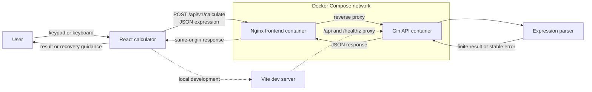
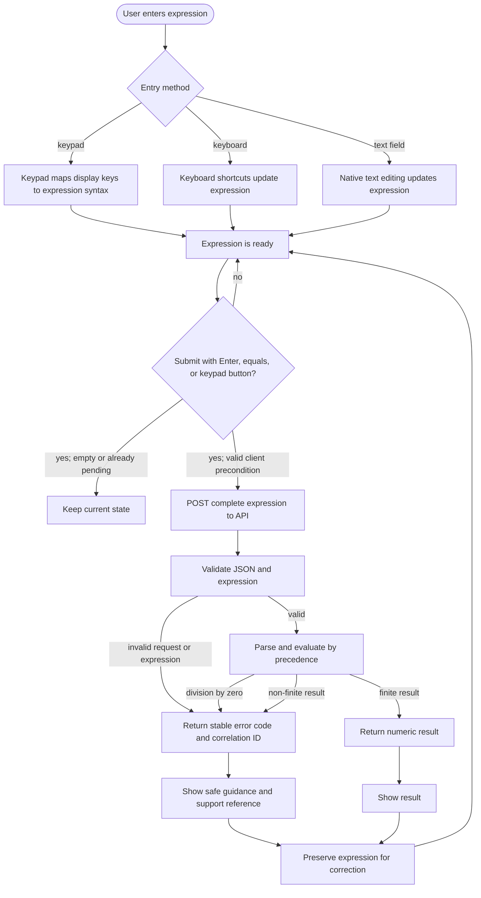
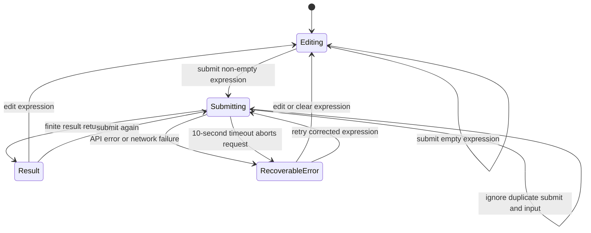
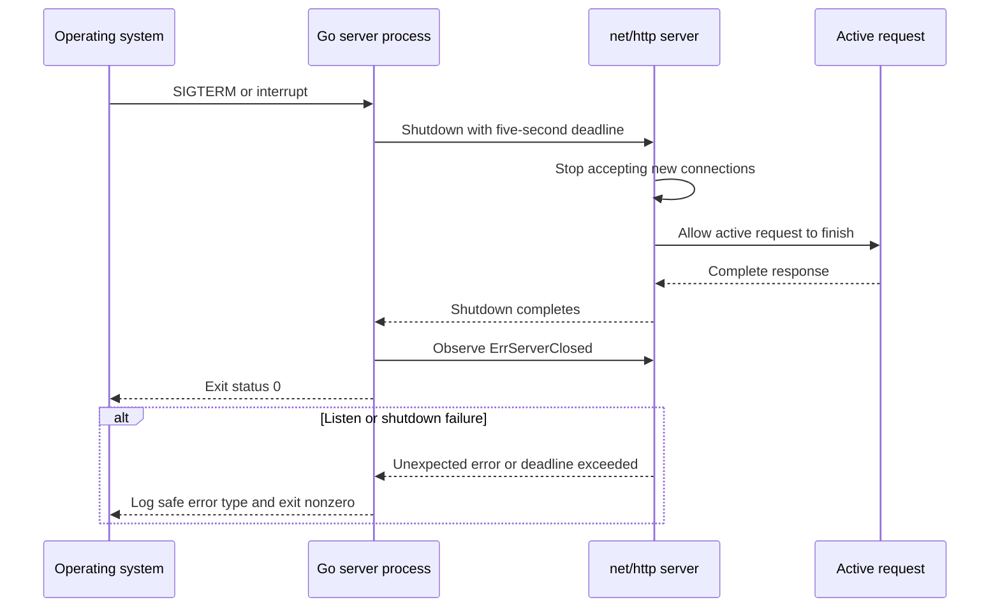

# Calculator architecture and behavior

This document describes the calculator's runtime boundaries and the paths a request follows. The browser owns expression entry and presentation; the Go API is the authority for parsing and arithmetic. The API is stateless and evaluates one submitted expression at a time.

## Overall architecture



The Compose deployment publishes the Nginx frontend on the host. Nginx serves the compiled React files and forwards `/api/` and `/healthz` requests to the private `api` service. During development, Vite performs the same proxy role. The Go API exposes `GET /healthz` and `POST /api/v1/calculate`.

## Expression evaluation flow



Operator precedence in the parser is addition/subtraction, multiplication/division, unary signs, right-associative exponentiation, postfix percentage, and primary values (`sqrt(...)`, parentheses, or numbers). The UI does not compute arithmetic locally.

## UI state model



Editing clears stale result and error feedback. During submission the input and keypad are disabled to prevent overlapping calculations, and the status reads “Calculating…”. A 10-second browser deadline aborts a stalled fetch, displays timeout recovery, and re-enables controls. A failed request leaves the expression visible so the user can edit and retry. Response JSON is validated as an object envelope, finite numeric results and string error code/reference fields before UI state changes; malformed shapes follow the safe invalid-response path. Error details shown in the UI are selected from stable error codes; raw exceptions are not displayed.

## Calculation request sequence

```mermaid
sequenceDiagram
  actor User
  participant UI as React calculator
  participant Proxy as Nginx or Vite proxy
  participant API as Go/Gin API
  participant Parser as Expression parser
  participant Log as LogTape client logger

  User->>UI: Enter full expression and submit
  UI->>UI: Check non-empty expression and pending state
  UI->>Proxy: POST /api/v1/calculate { expression }
  Proxy->>API: Forward request
  API->>API: Limit and decode JSON; reject unknown or trailing data
  API->>Parser: Parse and evaluate expression
  alt Valid finite result
    Parser-->>API: number
    API-->>Proxy: 200 { result }
    Proxy-->>UI: JSON response
    UI->>UI: Display result and clear pending state
  else Input or calculation error
    Parser-->>API: stable error category
    API-->>Proxy: 4xx/422 { error: { code, correlation_id } }
    Proxy-->>UI: JSON error
    UI->>UI: Display recovery guidance and support reference
  else Malformed JSON response
    UI->>UI: Validate object, result and error field types
    UI->>Log: Record invalid_response without response contents
    UI->>UI: Display generic recoverable response message
  else Network failure
    Proxy--xUI: Request unavailable
    UI->>Log: Record operation and safe error category once
    UI->>UI: Display connection recovery guidance
  else Request takes longer than 10 seconds
    UI->>UI: AbortController cancels fetch
    UI->>Log: Record request_timeout without expression or exception
    UI->>UI: Show timeout recovery and re-enable controls
  end
```

## User activity

```mermaid
flowchart TD
  begin([Begin]) --> choose[Choose keypad, keyboard, or expression field]
  choose --> compose[Compose expression]
  compose --> review[Review visible expression]
  review --> action{Calculate now?}
  action -->|No| compose
  action -->|Yes| send[Submit once]
  send --> wait[Wait with calculating feedback and 10-second deadline]
  wait --> outcome{Response}
  outcome -->|Success| result[Read result]
  outcome -->|Recoverable error| correction[Read action guidance and support reference]
  outcome -->|Timeout| correction
  correction --> compose
  result --> next{Continue?}
  next -->|Yes| compose
  next -->|No| end([Done])
```

Keyboard controls outside editable fields are digits and operators, `Shift+6` for exponentiation, `x` for multiplication, `s` for square root, `Backspace` to delete, `Escape` to clear, and `Enter` or `=` to calculate. Enter retains native activation for a focused button or link; after a keypad click, the first global expression key blurs the button so later shortcuts in the sequence continue to work and Enter calculates. `Shift+6` is also translated to exponentiation when the expression field has focus; replacing a selected `^` collapses the caret immediately. When the expression field is focused, native form submission calculates. Client transport and malformed-response failures are logged once as LogTape JSON Lines records with only an operation and safe failure category.

## API process shutdown



The process waits for the shutdown result before returning. If startup fails or the graceful deadline expires, it exits nonzero so container supervisors and shell automation can detect the failure.

## Container lifecycle

```mermaid
sequenceDiagram
  actor User
  participant Script as scripts/containers.sh
  participant Compose as Docker Compose
  participant APIImage as Go API image
  participant WebImage as Nginx frontend image

  User->>Script: start
  Script->>Compose: up -d --build
  Compose->>APIImage: Build Go binary and non-root runtime image
  Compose->>WebImage: npm ci, build React assets, copy into Nginx image
  Compose->>Compose: Start api and web on private network
  Compose-->>Script: Containers started
  Script-->>User: Frontend URL
  User->>Script: stop
  Script->>Compose: stop web api
  Compose-->>User: Both containers stopped; containers retained
```

## Code and tests

`docs/code-walkthrough.md` maps these responsibilities to source files. [PR review follow-ups](review-followups.md) explain the reproduced findings and their fixes. Go tests cover parser, HTTP contracts, process errors, and signal shutdown. Vitest covers the component, logging categories, native keyboard activation, and timeout recovery. Every Cucumber/Playwright scenario runs at `1080x1920`, `1366x768`, and `1920x1080`; a long-result scenario also runs at `320x720`. The GitHub Actions workflow runs these checks and builds both images.
